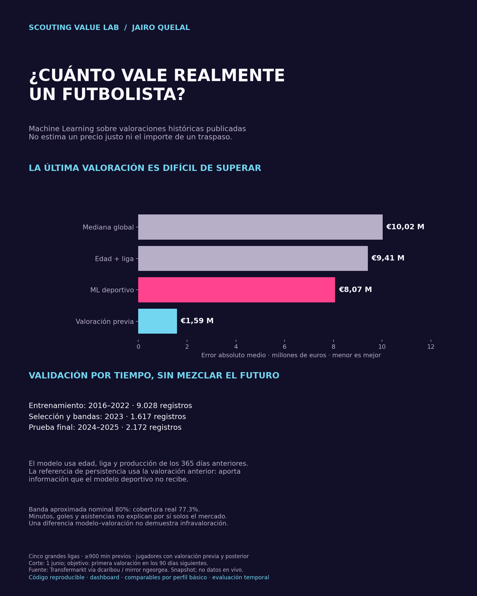

<<<<<<< HEAD
# ⚽ Scouting Value Lab

**¿Cuánto vale realmente un futbolista?** Un laboratorio de Machine Learning que aproxima valoraciones históricas publicadas y muestra por qué el rendimiento básico no explica todo el mercado.



Incluye pipeline reproducible, dos modelos, cuatro referencias/resultados, evaluación temporal, bandas empíricas y dashboard para explorar jugadores y comparables. **No calcula precios justos ni demuestra infravaloración.**

## Ejecutar el dashboard con resultados incluidos

```bash
python -m venv .venv
source .venv/bin/activate
pip install -e '.[dev]'
streamlit run app.py
```
En Windows: `.venv\Scripts\activate`. El explorador utiliza CSV de prueba incluidos; no necesita descargar el dataset ni cargar el modelo serializado.

## Reproducir el entrenamiento

```bash
python -m scouting_value_lab.pipeline --download
python -m scouting_value_lab.report
pytest -q
```
Descarga cuatro tablas públicas del mirror (aproximadamente 200 MB). Se necesita conexión a Internet. Insumos excluidos del repositorio. Un fallo de descarga no genera ejemplos sintéticos: hay que resolverlo antes de entrenar. Comparar SHA256 con `artifacts/data_manifest.json` para verificar snapshot.

## Diseño

1. Corte anual: 1 junio. Producción de los 365 días previos, solo cinco grandes ligas.
2. Cohorte ≥900 min, valoración positiva previa y actualización posterior en 90 días.
3. Entrenamiento 2016–2022; selección/calibración 2023; prueba 2024–2025.
4. Ridge y árboles gradient boosting estiman log(1+valor). No entran valor actual, máximo histórico, club actual ni posición de snapshot.
5. Se comparan con persistencia, edad+liga y mediana global; selección independiente de prueba.

## Resultados del snapshot utilizado

- 9.028 registros de entrenamiento; 1.617 de validación; 2.172 de prueba.
- Modelo elegido: HistGradientBoosting, por MAE log de validación.
- MAE de prueba: **€8,07 M** para el modelo deportivo, **€9,41 M** para edad+liga y **€1,59 M** para conservar la valoración previa.
- Banda empírica nominal 80%: cobertura de prueba **77,3%**, sin garantía fuera de esta muestra.

El modelo deportivo no supera la información del mercado previo. Ese resultado forma parte del proyecto: no se esconde ni se convierten errores del modelo en listas de jugadores “baratos”.

## Estructura

- `src/scouting_value_lab/pipeline.py`: cohortes temporales, entrenamiento y métricas.
- `src/scouting_value_lab/similarity.py`: comparables básicos por distancia.
- `app.py`: explorador Streamlit, evaluación y documentación.
- `artifacts/`: predicciones de prueba, modelo, métricas, manifiesto y gráfica.
- `tests/`: controles de fechas y exclusión de identidad en comparables.
- `docs/MODEL_CARD.md`: decisiones, sesgos y alcance.

## Límites y siguiente versión

No son valores actuales. Datos históricos reconstruidos desde un snapshot; puede haber revisiones posteriores. Jugadores repetidos entre años; no se evalúa solo a jugadores nuevos. Modelo básico sin contratos, lesiones ni eventos detallados. La posición en comparables es retrospectiva. Antes de interpretar estilos o valor económico, incorporar datos históricos de roles, rendimiento defensivo y contexto; ampliar validaciones temporales y bandas por grupos.

Fuente: Transfermarkt vía [dcaribou](https://github.com/dcaribou/transfermarkt-datasets), mirror [ngeorgea](https://huggingface.co/datasets/ngeorgea/transfermarkt-player-scores). Datos upstream CC0; código del proyecto MIT. Ver [ficha del modelo](docs/MODEL_CARD.md) y [resultados](docs/RESULTS.md).

Para reproducir las versiones usadas: `pip install -r requirements-lock.txt` y después `pip install -e . --no-deps`. El modelo serializado usa scikit-learn 1.8.0; el dashboard explora resultados CSV y no deserializa modelos.
=======
# scouting-value-lab
⚽ Machine learning for historical football player market valuation, player similarity exploration, and temporal model evaluation. Includes an interactive Python dashboard.
>>>>>>> d29c30b96ddd85d0814baa48a153a8b889a56d09
